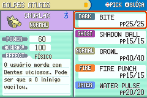
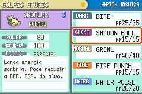

# IA de duplas e migração dos golpes — desenvolvimento

Este documento descreve os fontes após a v0.4.0-dev. Não significa que a Release antiga já contenha estas mudanças. A migração completa para geração IX continua incompleta.

## Interface corrigida

A categoria fica na coluna dos valores, na linha EFFECT, separada de poder, precisão e descrição. As descrições são traduzidas antes da quebra de linhas e medidas em pixels, usando fonte pequena em até cinco linhas. Foram revisadas 14 traduções longas. A seleção dos cinco golpes foi percorrida por botões em EN e PT-BR; o teste também confere os limites de linhas das 354 descrições nos dois idiomas. As imagens abaixo foram conferidas visualmente.

## O que a IA faz

- Compara os dois adversários e mantém os critérios nativos de viabilidade, nocaute e HP. Quando as notas empatam, compara dano estimado, precisão e HP restante do alvo; não escolhe um alvo resistente ao acaso nesse empate.
- Considera PP e limitações de golpes do próprio parceiro para Helping Hand. Desencoraja apoiar um parceiro que já escolheu uma ação sem dano e favorece um ataque quando o aliado já escolheu Helping Hand.
- Desencoraja repetir a mesma tela ou o mesmo clima que o parceiro já escolheu. Mantém verificações de efeitos já ativos e de habilidades do próprio time que suprimem o clima.
- Mantém o valor de dano de Rock Tomb/Icy Wind quando não podem mais baixar velocidade. Icy Wind também recebe a consideração de atingir dois adversários.
- Penaliza Protect/Detect consecutivos e reduz o uso sem uma razão de desgaste/sobrevivência.
- Penaliza Earthquake com aliado vulnerável e reconhece imunidade de Flying/Levitate.
- Desempata apenas entre golpes utilizáveis, sem duplicar entradas na lista de escolha e sem ressuscitar um golpe bloqueado com um bônus de suporte.

Ainda é uma IA heurística: não planeja conjuntamente todas as combinações de duas ações, não faz busca de vários turnos e não prevê a ação enfileirada pelo jogador. Trocas e itens da mochila continuam usando a lógica nativa. O cálculo nativo conserva suas suposições sobre atributos, itens e habilidades adversárias; não é uma IA de informação estritamente oculta. Movimentos de dano variável e condições especiais merecem novos testes durante a expansão. Não há fundamento para chamá-la de perfeita ou garantir que sempre execute a melhor jogada competitiva.

## Ginásios

Os oito líderes continuam com seis integrantes, seus tipos e tetos anteriores. As naturezas, habilidades e EVs agora são explícitos e aplicados ao criar o adversário. Os sets foram conferidos contra os learnsets atualmente importados, incluindo espaços antes dos níveis baixos no cabeçalho C.

| Líder | Plano de dupla |
|---|---|
| Brock | Thunder Wave/Rock Tomb de Nosepass e pressão de Omanyte; Onix mantém a posição de ace. |
| Misty | Chuva de Poliwhirl com Fake Out/Swift Swim de Lombre; Psyduck usa Damp, evitando suprimir o próprio clima. |
| Surge | Chuva de Electrode, Thunder/Surf de Lanturn e telas/cobertura nos reservas. Surf ainda segue a regra nativa da geração III neste build. |
| Erika | Sol/paralisia de Tangela, Fake Out de Shiftry, Chlorophyll e Solar Beam. |
| Koga | Nidoqueen/Gengar na abertura; Earthquake com Levitate, além de Crobat/Weezing imunes a Ground e suporte de status. |
| Sabrina | Fake Out/telas de Mr. Mime e Helping Hand de Espeon, com pressão especial e Surf de Slowbro. |
| Blaine | Sunny Day de Ninetales, Heat Wave de Torkoal/Arcanine e Helping Hand de Flareon. |
| Giovanni | Earthquake de Donphan ao lado de Gligar; Flygon oferece outra imunidade e Nidoqueen dá suporte/cobertura. |

Sets completos: [TRAINER_REVIEW.md](TRAINER_REVIEW.md). Manifesto editável: [data/gym_doubles_teams.json](data/gym_doubles_teams.json). Lorelei teve Toxic de Cloyster substituído por Spikes para respeitar a compatibilidade importada. Os testes de dificuldade dos 35 desafios continuam sendo evidência histórica da ROM v0.4.0; suas taxas não devem ser atribuídas aos times novos. Ainda falta recalibrar a campanha com estas mudanças.

## Estado da geração IX

| Pedido | Estado nos fontes |
|---|---|
| Learnsets dos 386 | Importação de nível/TM feita para os golpes já existentes. Não contém todos os golpes das tabelas originais. |
| Espécies ausentes de SV | Último jogo oficial com tabela de nível disponível: BDSP ou Legends: Arceus neste snapshot, conforme autorização do usuário. |
| Poder, precisão, PP e prioridade | Dados modernos importados para os 354 golpes implementados. |
| Físico/especial/status | Categoria por golpe aplicada ao dano, burn, telas, Hustle, registro de dano para Counter/Mirror Coat e treinamento por função; categoria visível no resumo, batalha e TM Case. |
| Itens/habilidades ligados à categoria | Thick Fat, bônus de tipo, clima e Flash Fire também consideram golpes físicos dos respectivos tipos. |
| Loja de Celadon | As 50 TMs existentes estão disponíveis antes da Liga. O catálogo completo de SV/DLC ainda não foi implementado. |
| Todos os golpes novos | **Pendente:** 225 golpes ausentes para cobrir nível/TM dos 386 neste recorte, depois de reconhecer High Jump Kick como o Hi Jump Kick já existente e excluir Tera Blast. |
| Efeitos modernos completos/Fairy/atributos base | **Pendentes.** Atualizar números e categoria não equivale a portar todos os efeitos e regras das gerações recentes. |

Não foram inseridos golpes com efeito fictício para preencher o catálogo. Z-Moves, Max/G-Max e golpes dependentes de Terastalização continuam fora do escopo. A auditoria de lacunas é [data/gen9_coverage.json](data/gen9_coverage.json); a importação parcial é [data/learnset_import.json](data/learnset_import.json).

Fonte dos dados: [PokeAPI, revisão fixa 2bf639e](https://github.com/PokeAPI/pokeapi/tree/2bf639e5572812a67d2b94903fdcb9d095f5aeb2/data/v2/csv). URLs e hashes estão no manifesto em `data/upstream/pokeapi/manifest.json`. O projeto usa tabelas geradas e não executa código remoto para obter os dados.

## Testes e reprodução

`scripts/test_move_data.py` confere as categorias/poder/precisão dos 354 golpes, a leitura de nível 1 com espaço, o estoque de 50 TMs e a importação dos 386. `scripts/test_ai_move_native.py` executa 1.046 verificações nativas, incluindo alvos, limitações, suporte, dano e os seis integrantes de cada ginásio: espécie, nível, item, habilidade, natureza, IVs, EVs e golpes. Não certifica vitórias de campanha. `scripts/test_category_ui.py` percorre dez posições de interface em dois idiomas e verifica 708 descrições; a inspeção visual complementa os resultados.

Para obter o snapshot dos dados, execute `python scripts/fetch_gen9_data.py`. A ordem dos geradores é `audit_gen9_coverage.py`, `import_move_stats.py`, `import_learnsets.py`, `balance_trainers.py`, `generate_locale.py`, `generate_guides.py`. Execute `export_source_patch.py` depois das edições. Os testes nativos e de interface rodam no Ubuntu/WSL com mGBA e uma compilação atual em `output/hack-build-path.txt`.

Os resultados anteriores de captura, campanha assistida e dificuldade não homologam automaticamente este build. A campanha natural, randomizer e o equilíbrio depois da modernização exigem novas baterias.

Validação consolidada: [data/modernization_validation.json](data/modernization_validation.json), ROM SHA-256 `6a68558250a93e23335c75a713c2fdda9f018b2cdca0444d940788603f188354`. As sete suítes de regressão passaram; os 46 testes de lojas correspondem ao mesmo SHA. A compilação limpa do patch produziu ROM idêntica. A suíte da E4 usa HP ampliado no time de teste para observar criação e avanço de turnos; não demonstra vitória. A prova de dificuldade antiga pode ser conferida com `validate_challenge_evidence.py --reference-rom CAMINHO_DA_ROM_V0.4.0`, sem confundir os dois builds.
