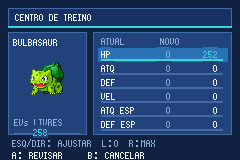

# FireRed 386

## Status do Super HeartGold nativo — 30/10/2026

**Ainda não jogável.** Objetivo: engine nativa no Windows com single screen.
Os percentuais das issues #6–#13 são estimativas de avanço dentro de cada escopo,
baseadas nos testes e pendências documentados; não representam prazo nem parcela
jogável do jogo. 100% significa apenas que o escopo daquela issue foi concluído.

| Issue | Entrega | Progresso | Estado e evidência / próxima etapa |
|---|---|---:|---|
| [#5](https://github.com/matheus013/firered-386/issues/5) | Acompanhamento geral | 25% das entregas encerradas (2/8) | Indicador administrativo; não é percentual de conclusão do jogo. |
| [#6](https://github.com/matheus013/firered-386/issues/6) | Carregadores Nitro 2D | 100% | Concluída: 17 recursos × 512 ciclos com sanitizadores; limites documentados. |
| [#7](https://github.com/matheus013/firered-386/issues/7) | Seis fundos da cena 4 | 100% | Concluída: comparação pixel a pixel e alternância single screen. |
| [#8](https://github.com/matheus013/firered-386/issues/8) | Sprites e animações | 85% | Transferências iniciais/diferidas, troca de recursos no VBlank e SpriteList/OAM originais aprovados em diagnóstico; falta integrar e validar a cena completa. |
| [#9](https://github.com/matheus013/firered-386/issues/9) | Fades, janelas e HBlank | 75% | Fades 8/9 com BG1 + OBJ e pan original com WIN0/WIN1 validados; faltam 3D, janela OBJ e cena completa. |
| [#10](https://github.com/matheus013/firered-386/issues/10) | Abertura original e menu | 10% | Janelas + scroll da cena 4 aprovados juntos em diagnóstico; boot e chegada ao menu ainda não executados. |
| [#11](https://github.com/matheus013/firered-386/issues/11) | Build e execução Windows | 15% | Componentes nativos testados; executável completo e fluxo single screen Windows pendentes. |
| [#12](https://github.com/matheus013/firered-386/issues/12) | Primeiro trecho jogável e save | 0% | Entrada de Nova Partida/campo/batalha compila; link executável, percurso e save/retomada pendentes. |
| [#13](https://github.com/matheus013/firered-386/issues/13) | Campanha e pós-jogo | 0% | Validação ponta a ponta ainda não iniciada. |

[Evidências e critérios por issue](games/super-heartgold/docs/github-issues-plan.md) ·
[Testes gráficos e limites](games/super-heartgold/docs/scene4-graphics-references.md).
[Levantamento do mínimo jogável no Windows](games/super-heartgold/docs/minimum-playable.md): primeiro mapa, eventos, batalha e save; a cinematica completa não é requisito desse marco.
A documentação de FireRed abaixo trata de outro jogo deste repositório.

O README fica na raiz; os guias, relatórios de testes e o histórico de mudanças ficam em `docs/`. Os comandos de reprodução continuam sendo executados na raiz do projeto.

**Prévia atual: [v0.5.0-preview.6](https://github.com/matheus013/firered-386/releases/tag/v0.5.0-preview.6)** — veneno fora de batalha para em 1 HP e é curado, sem desmaios. Inclui Pickup por faixa de nível, aviso de item na captura, cores de natureza no resumo e no editor, e Pokémon selvagens sempre com item quando a espécie tem um. Mantém Fada, 223 golpes novos e EVs desde o início no Normal. [Histórico](docs/CHANGELOG.md). A migração completa para as regras modernas continua em desenvolvimento.

**Desenvolvimento após v0.4.0:** há revisão da IA/ginásios, categorias por golpe, correção de sobreposição e importação parcial dos learnsets recentes. Estas mudanças ainda não completam a geração IX nem atualizam automaticamente a Release antiga. [Estado exato, testes e pendências](docs/MODERNIZATION.md). [Revisão da IA dos líderes/E4](docs/AI_REVIEW.md).

Hack de Pokémon FireRed para GBA, com história e mapas preservados, foco em duplas e melhorias de qualidade de vida. **Versão de desenvolvimento, ainda incompleta.** As 386 espécies já estão distribuídas em encontros capturáveis; as demais melhorias pendentes estão listadas abaixo.

Guias: [onde capturar cada uma das 386 espécies](docs/SPECIES_LOCATIONS.md) · [times dos desafios em sequência](#times-dos-desafios-em-sequência) · [encontros por rota, níveis e probabilidades](docs/ENCOUNTERS.md) · [catálogo de todos os treinadores](docs/TRAINER_REVIEW.md).

[Avaliação de balanceamento da v0.4.0-dev](docs/BALANCE_REVIEW.md): comparação entre Normal/Hardcore, gargalo de EXP na Liga, preparação dos desafios e restrições de cura. É uma auditoria de dados e modelos; a campanha completa sem assistência continua pendente.

**Validação anterior, v0.3.1-dev:** corrigidos os três bugs da auditoria (IVs, status dos errantes e teto da creche) e o consumo indevido de cota pelo Marowak fantasma. Passaram 23 casos de captura, com cotas nos 124 mapas de encontros, 28 casos de Pokémon/creche e sete suítes de regressão. Veja o [checklist e pendências manuais](docs/TEST_CHECKLIST.md) e os [testes de captura](docs/CAPTURE_TEST_RESULTS.md).

## Compilar para GBA ou PC

```sh
make -C games/super-fire-red -f hack.mk gba   # ROM GBA
make -C games/super-fire-red -f hack.mk pc    # executável nativo: Windows no WSL, Linux fora do WSL
```

No Windows, execute pela raiz com `wsl -d Ubuntu -u root -- make -C games/super-fire-red -f hack.mk pc`. Instale as dependências adicionais uma vez com `make -C games/super-fire-red -f hack.mk setup-native`. Saídas: `games/super-fire-red/output/firered-386-dev.gba` e `games/super-fire-red/output/pc/windows/firered-386.exe` (ou `games/super-fire-red/output/pc/linux/firered-386`). O port PC compila a engine em C para x86, usa SDL2 e está em fase experimental; a campanha completa e a conectividade ainda não foram validadas nele. [Instalação, comandos, controles e testes](docs/NATIVE_BUILD.md).

## Download

Prévia atual: **[v0.5.0-preview.6](https://github.com/matheus013/firered-386/releases/tag/v0.5.0-preview.6)** — [baixar o .gba](https://github.com/matheus013/firered-386/releases/download/v0.5.0-preview.6/firered-386-v0.5.0-preview.6.gba). **Ainda não contém todos os golpes nem todas as TMs da geração IX.** [Testes e limites](docs/MODERNIZATION.md).

As releases anteriores foram removidas; o código de cada versão continua nas tags (v0.1.0-dev a v0.5.0-preview.4); a v0.5.0-preview.5 continua publicada. Veja o [histórico de versões](docs/CHANGELOG.md).

Baixe o **`.gba`** em [Releases](https://github.com/matheus013/firered-386/releases) e abra em um emulador de GBA. Também estão disponíveis um patch `.ips`, o patch de fontes e checksums SHA-256.

O IPS exige uma ROM limpa de **FireRed USA 1.0**, SHA-1 `41cb23d8dccc8ebd7c649cd8fbb58eeace6e2fdc`. O `.gba` já compilado dispensa aplicar patches. Para escolher Hardcore, use **NEW GAME**. Saves anteriores à introdução dos modos são tratados como Normal; a escolha já gravada em um Hardcore é preservada. Faça backup do seu save antes de experimentar outra versão.

Para continuar uma partida, preserve uma cópia do `.sav` e use o mesmo nome-base para ROM e save, por exemplo `firered-386.gba` e `firered-386.sav`. O layout do save foi preservado e os testes de gravação/recarga passaram; a migração de saves reais de cada versão anterior ainda precisa ser validada. Os novos encontros passam a valer ao jogar com a ROM atualizada.

Idioma selecionável em **OPTIONS: ENGLISH / PT-BR**. O português está em beta: 7.865 entradas traduzidas, com 1.202 substituições revisadas, incluindo as 354 descrições de golpes e 288 de itens. Menus, habilidades, mensagens de batalha, Centros Pokémon e diálogos iniciais foram revisados. Muitos diálogos secundários ainda vêm do rascunho automático. Nomes de Pokémon, golpes, habilidades e naturezas permanecem em inglês; caracteres sem suporte na fonte são simplificados. [Revisão, exemplos e testes do PT-BR](docs/PTBR_REVIEW.md).

Ao criar o save: **Normal/Hardcore → Randomizer OFF/ON**. O randomizer troca encontros selvagens, iniciais e espécies/golpes dos treinadores, preservando níveis e tamanhos dos elencos; sua semente fica gravada. Encontros roteirizados e presentes permanecem fixos. Os times e locais dos guias representam o randomizer desligado. [Detalhes e limites](docs/SETTINGS.md).

O cientista mostra retrato, painéis azuis, barras de EV/IV, saldo de EVs e prévia dos atributos antes da confirmação. **Normal: EVs desde o início; IVs e natureza após a Liga. Hardcore: os três desde o início.** [Revisão da interface e testes](docs/UI_REVIEW.md).



[Validação da v0.4.0-dev](docs/FEATURE_TEST_RESULTS.md): configurações, salvamento, randomizer, desafios, interface e regressões na ROM compilada. A campanha completa sem assistência continua pendente.

<!-- GENERATED CHALLENGE TEAMS START -->
## Times dos desafios em sequência

Roteiro sugerido dos desafios principais e opcionais de destaque da versão atual. A exploração permite mudar algumas ordens; os tetos continuam seguindo a sequência de insígnias. Os demais treinadores e a Torre estão em [TRAINER_REVIEW.md](docs/TRAINER_REVIEW.md).

Cada equipe aparece na ordem do elenco: nas duplas, os dois primeiros abrem a luta. No rival e no Campeão, **a variante indica o inicial do rival**, não o seu: você escolhe Bulbasaur → rival Charmander; Charmander → rival Squirtle; Squirtle → rival Bulbasaur. Não existe equipe única comum às três variantes.

Os detalhes de golpes, itens e treinamento de cada adversário estão no catálogo completo; abaixo, espécies e níveis extraídos dos mesmos dados usados na ROM.

### 01. Rival — laboratório de Oak

Primeira luta, simples; nível 5.

| Variante | Time em ordem de entrada |
|---|---|
| Squirtle | Squirtle **5** |
| Bulbasaur | Bulbasaur **5** |
| Charmander | Charmander **5** |

### 02. Rival — Route 22, primeira visita

Opcional, antes de Brock.

| Variante | Time em ordem de entrada |
|---|---|
| Squirtle | Squirtle **14** → Pidgey **14** |
| Bulbasaur | Bulbasaur **14** → Pidgey **14** |
| Charmander | Charmander **14** → Pidgey **14** |

### 03. Brock — Pewter Gym

| Variante | Time em ordem de entrada |
|---|---|
| Equipe | Nosepass **16** → Omanyte **16** → Geodude **16** → Kabuto **16** → Rhyhorn **17** → Onix **18** |

### 04. Rival — Cerulean City

Pode ocorrer antes ou depois de Misty.

| Variante | Time em ordem de entrada |
|---|---|
| Squirtle | Kadabra **24** → Pidgeotto **25** → Raticate **23** → Wartortle **26** |
| Bulbasaur | Kadabra **24** → Pidgeotto **25** → Raticate **23** → Ivysaur **26** |
| Charmander | Charmeleon **26** → Kadabra **24** → Raticate **23** → Pidgeotto **25** |

### 05. Misty — Cerulean Gym

| Variante | Time em ordem de entrada |
|---|---|
| Equipe | Poliwhirl **26** → Lombre **26** → Horsea **26** → Psyduck **26** → Staryu **27** → Starmie **28** |

### 06. Rival — S.S. Anne

| Variante | Time em ordem de entrada |
|---|---|
| Squirtle | Kadabra **32** → Raticate **30** → Pidgeotto **33** → Wartortle **34** |
| Bulbasaur | Kadabra **32** → Raticate **30** → Pidgeotto **33** → Venusaur **34** |
| Charmander | Charmeleon **34** → Raticate **30** → Kadabra **32** → Pidgeotto **33** |

### 07. Lt. Surge — Vermilion Gym

| Variante | Time em ordem de entrada |
|---|---|
| Equipe | Electrode **34** → Lanturn **34** → Manectric **34** → Electabuzz **34** → Magneton **35** → Raichu **36** |

### 08. Erika — Celadon Gym

A ordem entre este ginásio e o esconderijo Rocket pode variar.

| Variante | Time em ordem de entrada |
|---|---|
| Equipe | Tangela **42** → Shiftry **42** → Victreebel **42** → Bellossom **42** → Exeggutor **43** → Vileplume **44** |

### 09. Giovanni — Rocket Hideout

| Variante | Time em ordem de entrada |
|---|---|
| Equipe | Kangaskhan **44** → Rhyhorn **39** → Steelix **40** |

### 10. Rival — Pokémon Tower

| Variante | Time em ordem de entrada |
|---|---|
| Squirtle | Blastoise **48** → Arcanine **46** → Exeggutor **45** → Alakazam **43** → Pidgeot **48** |
| Bulbasaur | Alakazam **43** → Gyarados **46** → Arcanine **45** → Pidgeot **48** → Venusaur **48** |
| Charmander | Charizard **48** → Exeggutor **46** → Gyarados **45** → Alakazam **43** → Pidgeot **48** |

### 11. Koga — Fuchsia Gym

| Variante | Time em ordem de entrada |
|---|---|
| Equipe | Nidoqueen **50** → Gengar **50** → Crobat **50** → Tentacruel **50** → Venomoth **51** → Weezing **52** |

### 12. Koichi — Fighting Dojo de Saffron

Opcional; pode ser visitado antes de Koga. O nível acompanha a etapa de Saffron.

| Variante | Time em ordem de entrada |
|---|---|
| Equipe | Hitmonchan **54** → Hitmonlee **54** |

### 13. Rival — Silph Co.

| Variante | Time em ordem de entrada |
|---|---|
| Squirtle | Blastoise **58** → Arcanine **56** → Exeggutor **53** → Alakazam **53** → Pidgeot **55** |
| Bulbasaur | Alakazam **53** → Gyarados **56** → Arcanine **53** → Pidgeot **55** → Venusaur **58** |
| Charmander | Charizard **58** → Exeggutor **56** → Gyarados **53** → Alakazam **53** → Pidgeot **55** |

### 14. Giovanni — Silph Co.

| Variante | Time em ordem de entrada |
|---|---|
| Equipe | Nidoking **54** → Kangaskhan **53** → Rhydon **54** → Nidoqueen **58** |

### 15. Sabrina — Saffron Gym

| Variante | Time em ordem de entrada |
|---|---|
| Equipe | Mr. Mime **58** → Espeon **58** → Hypno **58** → Slowbro **58** → Girafarig **59** → Alakazam **60** |

### 16. Blaine — Cinnabar Gym

| Variante | Time em ordem de entrada |
|---|---|
| Equipe | Ninetales **66** → Torkoal **66** → Flareon **66** → Magmar **66** → Rapidash **67** → Arcanine **68** |

### 17. Biker Goon — Three Island, primeira luta

Visita às ilhas após Blaine; a sequência dos Bikers pode ser deixada para depois.

| Variante | Time em ordem de entrada |
|---|---|
| Equipe | Muk **68** → Weezing **68** |

### 18. Biker Goon — Three Island, segunda luta

| Variante | Time em ordem de entrada |
|---|---|
| Equipe | Arbok **68** → Weezing **68** |

### 19. Biker Goon — Three Island, terceira luta

| Variante | Time em ordem de entrada |
|---|---|
| Equipe | Muk **68** → Weezing **68** |

### 20. Paxton — líder dos Bikers de Three Island

| Variante | Time em ordem de entrada |
|---|---|
| Equipe | Muk **68** → Weezing **68** |

### 21. Giovanni — Viridian Gym

| Variante | Time em ordem de entrada |
|---|---|
| Equipe | Gligar **74** → Donphan **74** → Flygon **74** → Nidoqueen **74** → Marowak **75** → Rhydon **76** |

### 22. Rival — Route 22, antes da Liga

| Variante | Time em ordem de entrada |
|---|---|
| Squirtle | Rhydon **73** → Pidgeot **73** → Arcanine **73** → Exeggutor **73** → Alakazam **73** → Blastoise **78** |
| Bulbasaur | Rhydon **73** → Pidgeot **73** → Gyarados **73** → Arcanine **73** → Alakazam **73** → Venusaur **78** |
| Charmander | Charizard **78** → Rhydon **73** → Exeggutor **73** → Gyarados **73** → Alakazam **73** → Pidgeot **73** |

### 23. Lorelei — primeira Liga

| Variante | Time em ordem de entrada |
|---|---|
| Equipe | Hitmontop **78** → Cloyster **78** → Piloswine **78** → Jynx **78** → Tyranitar **79** → Lapras **80** |

### 24. Bruno — primeira Liga

| Variante | Time em ordem de entrada |
|---|---|
| Equipe | Hariyama **81** → Kyogre **81** → Ludicolo **81** → Slowbro **81** → Groudon **82** → Machamp **83** |

### 25. Agatha — primeira Liga

| Variante | Time em ordem de entrada |
|---|---|
| Equipe | Mawile **84** → Gengar **84** → Dusclops **84** → Misdreavus **84** → Tyranitar **85** → Lanturn **86** |

### 26. Lance — primeira Liga

| Variante | Time em ordem de entrada |
|---|---|
| Equipe | Hitmontop **87** → Kyogre **87** → Gengar **87** → Claydol **87** → Raichu **88** → Rayquaza **89** |

### 27. Campeão — primeira Liga

| Variante | Time em ordem de entrada |
|---|---|
| Squirtle | Blastoise **92** → Alakazam **87** → Rhydon **88** → Arcanine **88** → Exeggutor **90** → Pidgeot **88** |
| Bulbasaur | Rhydon **88** → Alakazam **87** → Pidgeot **88** → Gyarados **88** → Arcanine **90** → Venusaur **92** |
| Charmander | Charizard **92** → Alakazam **87** → Rhydon **88** → Exeggutor **88** → Gyarados **90** → Pidgeot **88** |

### 28. Administradora Rocket — Rocket Warehouse

Pós-jogo: etapa de recuperação da Sapphire.

| Variante | Time em ordem de entrada |
|---|---|
| Equipe | Arbok **86** → Muk **86** → Vileplume **86** |

### 29. Administrador Rocket — Rocket Warehouse

| Variante | Time em ordem de entrada |
|---|---|
| Equipe | Golbat **86** → Weezing **86** → Houndoom **86** |

### 30. Gideon — Rocket Warehouse

| Variante | Time em ordem de entrada |
|---|---|
| Equipe | Magneton **86** → Electrode **86** → Electrode **86** → Magneton **86** → Porygon2 **86** |

### 31. Lorelei — revanche

| Variante | Time em ordem de entrada |
|---|---|
| Equipe | Hitmontop **100** → Cloyster **100** → Piloswine **100** → Jynx **100** → Tyranitar **100** → Lapras **100** |

### 32. Bruno — revanche

| Variante | Time em ordem de entrada |
|---|---|
| Equipe | Hariyama **100** → Kyogre **100** → Ludicolo **100** → Slowbro **100** → Groudon **100** → Machamp **100** |

### 33. Agatha — revanche

| Variante | Time em ordem de entrada |
|---|---|
| Equipe | Mawile **100** → Gengar **100** → Dusclops **100** → Misdreavus **100** → Tyranitar **100** → Lanturn **100** |

### 34. Lance — revanche

| Variante | Time em ordem de entrada |
|---|---|
| Equipe | Hitmontop **100** → Kyogre **100** → Gengar **100** → Claydol **100** → Raichu **100** → Rayquaza **100** |

### 35. Campeão — revanche

| Variante | Time em ordem de entrada |
|---|---|
| Squirtle | Blastoise **100** → Alakazam **100** → Tyranitar **100** → Arcanine **100** → Exeggutor **100** → Heracross **100** |
| Bulbasaur | Tyranitar **100** → Alakazam **100** → Heracross **100** → Gyarados **100** → Arcanine **100** → Venusaur **100** |
| Charmander | Heracross **100** → Alakazam **100** → Tyranitar **100** → Exeggutor **100** → Gyarados **100** → Charizard **100** |

As novas revanches de líderes ainda não foram implementadas; por isso, não há times de revanche de ginásio inventados neste roteiro. Para planejar capturas, consulte [ENCOUNTERS.md](docs/ENCOUNTERS.md).

<!-- GENERATED CHALLENGE TEAMS END -->

## Todas as mudanças implementadas

### Batalhas e dificuldade

- Batalhas regulares de treinadores convertidas para duplas. A primeira luta contra o rival no laboratório permanece simples, nas três opções de inicial.
- **636 equipes regulares** revisadas, incluindo rivais posteriores, líderes, Elite Four, Campeão e revanches já existentes na base.
- Equipes de dois a seis integrantes; **líderes e Elite Four com seis Pokémon**. Líderes mantêm seu tipo; a E4 combina integrantes temáticos e parceiros dos times campeões.
- Suporte de abertura, cobertura, parceiros complementares, controle de velocidade, telas e clima em equipes compatíveis.
- Itens equipados e IVs progressivos. Níveis elevados por etapa da campanha, evoluções mais avançadas e Campeão com natureza, habilidade, IVs 31 e EVs por função.
- Elencos genéricos evitam dano ao aliado, nocaute em um acerto e acúmulo de evasão. Koga/Giovanni têm Earthquake com parceiros imunes e cobertura alternativa nos novos times curados. Clima é evitado em equipes que possam ter Cloud Nine ou Air Lock.
- **60 elencos internos da Torre de Treinadores** revisados para duplas; segundo Pokémon adicionado aos adversários do modo Knockout. Níveis continuam acompanhando a equipe do jogador; IVs agora são 31 e EVs/natureza seguem a função do Pokémon. Dados externos de e-Reader não foram revisados.
- Com apenas um Pokémon apto, o jogador enfrenta dois adversários com o segundo espaço vazio, sem duplicação ou exigência de um segundo integrante.

Os fontes de desenvolvimento usam categorias, poder e precisão modernos, e learnsets recentes limitados aos golpes implementados. Parte dos efeitos e das demais regras permanece na geração III. A Release v0.4.0 anterior conserva suas tabelas originais. Líderes, rivais (incluindo o laboratório), chefes Rocket, Koichi, Bikers, E4/Campeão e Torre recebem IVs 31 e EVs treinados. Os demais treinadores preservam sua escala de IVs; a calibração da campanha inteira continua pendente. Cada equipe, nível, item e golpe pode ser consultado em [TRAINER_REVIEW.md](docs/TRAINER_REVIEW.md), com dados em [games/super-fire-red/hack-data/trainer_balance.json](games/super-fire-red/hack-data/trainer_balance.json).

### Elite Four inspirada em campeões oficiais (v0.1.1-dev)

| Membro | Referência mundial | Seis Pokémon na hack |
|---|---|---|
| Lorelei | Abram Burrows, Junior 2012 | Hitmontop, Cloyster, Piloswine, Jynx, Tyranitar, Lapras |
| Bruno | Ray Rizzo, Senior 2010 | Hariyama, Kyogre, Ludicolo, Slowbro, Groudon, Machamp |
| Agatha | Nikolai Zielinski, Senior 2014 | Mawile, Gengar, Dusclops, Misdreavus, Tyranitar, Lanturn |
| Lance | Wolfe Glick, Masters 2016 | Hitmontop, Kyogre, Gengar, Claydol, Raichu, Rayquaza |

- Aplicado à primeira Liga e às revanches: oito elencos com seis integrantes. Os maiores níveis da primeira Liga são 80/83/86/89; o Campeão chega ao 92. Na revanche, todos os seis Pokémon de cada membro e do Campeão ficam no nível 100.
- Naturezas e habilidades fixas, IVs 31 e EVs distribuídos por função, efetivamente aplicados na criação dos adversários.
- Helping Hand, Intimidate, Fake Out de Hariyama, telas, sono, queimadura/paralisia e cobertura respeitam os recursos disponíveis na geração III.
- Espécies históricas disponíveis preservadas; as ausentes foram substituídas por parceiros das 386 espécies. As equipes são mistas e não exigem que todos compartilhem o tipo do membro.
- **São adaptações dos campeões**, sem Mega Evolução, Reversão Primal ou Trick Room. As interações de clima exigem cuidado: Groudon substitui a chuva, Rayquaza suspende seus efeitos e a areia de Tyranitar também atinge parceiros não imunes.

Estratégias, substituições e fontes: [E4_CHAMPIONS.md](docs/E4_CHAMPIONS.md). Sets completos, EVs, naturezas e habilidades: [TRAINER_REVIEW.md](docs/TRAINER_REVIEW.md).

### Decisões dos NPCs

- A IA compara os dois adversários; no empate de notas, considera dano estimado e precisão. Considera planos já escolhidos pelo próprio parceiro, sem ler a ação enfileirada pelo jogador.
- Helping Hand considera PP/limitações e ações já escolhidas pelo parceiro. Um aliado que receberá suporte favorece golpes de dano.
- Telas/clima ativos ou já escolhidos pelo aliado recebem penalidade. Protect/Detect consecutivos são desencorajados.
- Controle de velocidade e clima recebem pontuação conforme sua utilidade.
- Golpes contra ambos os adversários recebem incentivo quando os dois estão presentes.
- Dano ao aliado recebe penalidade quando o parceiro está presente e não é imune.
- Um golpe desabilitado não volta a ser escolhido apenas por receber bônus de suporte.

A revisão melhora a pontuação de ações, mas não garante decisões perfeitas em todas as situações.

### Golpes e TMs no build de desenvolvimento

- Categoria físico/especial/status aplicada por golpe, com identificação no resumo, batalha e TM Case.
- Poder, precisão, PP e prioridade importados para os 354 golpes existentes. Efeitos modernos completos continuam pendentes.
- Todas as 50 TMs existentes são vendidas no segundo andar de Celadon antes da Liga. O catálogo completo de Scarlet/Violet e DLCs ainda falta.
- Categoria reposicionada na linha EFFECT; descrições medidas e quebradas em linhas para não invadir a lista de golpes.

### Experiência, itens e evolução

- **Exp. Share global após entregar o Parcel ao Professor Oak**, como item-chave que liga/desliga o efeito, sem ocupar item equipado.
- Cada participante recebe experiência integral; cada reserva apta recebe metade. Ovos e Pokémon desmaiados não recebem. Nos dois modos, vale o teto de nível da progressão.
- **TMs reutilizáveis:** não são consumidas ao ensinar golpes.
- **Kadabra → Alakazam, Machoke → Machamp, Graveler → Golem e Haunter → Gengar no nível 37**, sem troca. As evoluções por troca com item também passam a ocorrer no **nível 37**: Onix → Steelix, Seadra → Kingdra, Scyther → Scizor, Porygon → Porygon2, Poliwhirl → Politoed e Clamperl → Huntail. Os ramos alternativos usam o item direto da mochila: King's Rock → Slowking e Deep Sea Scale → Gorebyss. Evoluções por pedra, amizade e beleza continuam como no original.
- **Pokédex Nacional junto com a Pokédex inicial**, sem antecipar os outros eventos da história.
- **Shiny em 1/256** nas rotinas comuns de geração e identificação. Rotinas que explicitamente impedem shiny continuam impedindo.

### Normal ou Hardcore Nuzlocke

- Escolha ao criar a partida, com revisão das regras antes da confirmação. B volta e A confirma; a introdução original continua em seguida.
- Escolha fixa, persistida no save. Saves anteriores à introdução dos modos permanecem em Normal.
- Normal conserva as melhorias da hack e o teto de EXP/nível, sem aplicar as demais restrições do Hardcore. Pokémon antigos acima do teto continuam utilizáveis no Normal, mas não ganham mais EXP até a progressão alcançá-los.

### Regras do Hardcore desta versão

1. **Perda permanente:** após as primeiras cinco Poké Balls de Oak, desmaios em batalha impedem o Pokémon de lutar novamente. Cura, Revive, Centro Pokémon e PC não desfazem a perda. Ele pode ficar guardado no PC. Veneno no mapa não mata: para em 1 HP e é curado.
2. **Primeiro encontro por área:** o primeiro selvagem elegível consome a oportunidade ao iniciar a batalha. Fugir ou derrotá-lo perde a captura. É permitido usar várias Poké Balls no mesmo encontro.
3. **Cota compartilhada:** grama, água, pesca e encontros estáticos na mesma seção do mapa compartilham a oportunidade. Andares/setores com a mesma seção também compartilham a cota.
4. **Duplicatas por espécie exata:** espécies registradas como capturadas são ignoradas sem consumir a área e não podem ser capturadas novamente. Não abrange toda a família evolutiva. Perdas e liberações não apagam o registro.
5. **Sem exceção shiny:** shinies seguem a cota normal.
6. **Presentes livres:** presentes, ovos, compras de Pokémon e trocas por NPC ficam fora da cota de selvagens, sem limite adicional por cidade. Continuam sujeitos à perda permanente e ao teto de nível.
7. **Mochila bloqueada em batalha**, exceto Poké Balls em encontros permitidos. Itens equipados e uso fora de batalha continuam disponíveis. Os adversários mantêm seus itens.
8. **Modo Set fixo**, inclusive na tela de opções.
9. **Limite de nível:** maior nível do primeiro líder ainda sem insígnia, na ordem dos oito ginásios. Após oito insígnias, sobe por membro da Liga: 80 → 83 → 86 → 89 → 92; após a Liga, 100. EXP e Rare Candy não ultrapassam o teto.
10. **Pokémon acima do teto** mantém o nível, mas fica indisponível até o limite alcançá-lo. Aparece com zero HP disponível nesse período, sem ser marcado como perdido por isso.
11. **Rare Candy por ₽1** nas lojas comuns, adicionado ao estoque somente no Hardcore. Venda rende ₽0, evitando lucro por revenda. Máquinas, prêmios por moedas e lojas de decoração ficam fora desta regra.
12. **Três curas por Centro Pokémon**, pela enfermeira, durante toda a partida. Cada um dos 19 Centros tem contador próprio; recusar a cura não gasta uso. O aviso mostra os usos restantes e a quarta cura é recusada. Normal mantém curas ilimitadas. Camas e recuperação pelo PC não entram neste contador.
13. **Derrota total** encerra a tentativa atual e mostra a tela de fim, com retorno ao menu para iniciar outra partida.

Capturas e perdas começam após as primeiras Poké Balls de Oak; limite, Set e restrição de itens valem desde a criação. Demonstrações, link e instalações de batalha ficam fora da marcação de perdas e da cota de captura.

Salvar pelo menu persiste o estado. **Não há autosave nem proteção contra recarregar um save anterior, save states, cheats ou edições externas.** A derrota bloqueia o estado atual em memória; recarregar um save anterior restaura aquele estado. Estas são as cláusulas desta hack, que podem diferir de outras variantes. Detalhes em [HARDCORE.md](docs/HARDCORE.md).

### Nova curva de níveis e treinador dos Centros (v0.2.0-dev)

| Desafio | Maior nível / teto antes da vitória |
|---|---:|
| Brock | 18 |
| Misty | 28 |
| Lt. Surge | 36 |
| Erika | 44 |
| Koga | 52 |
| Sabrina | 60 |
| Blaine | 68 |
| Giovanni | 76 |
| Lorelei / Bruno / Agatha / Lance | 80 / 83 / 86 / 89 |
| Campeão | 92 |
| Revanche da Liga inteira | 100 em todos os integrantes |

- Rotas, rivais, esconderijo, Silph, ginásios, Victory Road e treinadores das ilhas foram recalibrados por etapa. A primeira batalha no laboratório permanece simples e com os níveis originais. A Torre mantém seu escalonamento próprio.
- **NPC cientista nos 19 Centros Pokémon:** ajustes gratuitos. Normal libera EVs desde o início, e IVs/natureza após a primeira vitória na Liga. Hardcore libera os três desde o início.
- EVs de 0 a 252 por atributo, soma máxima 510; IVs de 0 a 31. A interface mostra os valores atuais, permite zerar/maximizar, cancelar e confirmar. EVs ganhos em batalha continuam ativos.
- O ajuste de natureza muda seu efeito e a natureza exibida, preservando personalidade, shiny, gênero e habilidade. Rotinas de preferências de sabor baseadas diretamente na personalidade mantêm a natureza de origem.
- Ovos, Pokémon perdidos e, no Hardcore, acima do teto não podem ser editados. Ajustes recalculam atributos sem recuperar HP ou reviver; reduzir o HP máximo pode reduzir o HP atual.
- O contador dos Centros é salvo junto da partida. Ao carregar um Hardcore anterior a esta versão, os contadores começam em zero. Não há autosave ou proteção contra recarregar um save anterior.

A geometria e a história permanecem preservadas; foram acrescentados os NPCs. Os encontros foram recalibrados em v0.3.0-dev, conforme a seção seguinte. Os níveis maiores, sozinhos, não comprovam equilíbrio da campanha completa. Detalhes e limites: [PROGRESSION.md](docs/PROGRESSION.md).

### Distribuição das 386 espécies (v0.3.0-dev)

- **386/386 espécies com captura selvagem direta**, no mesmo save Normal, sem depender de inicial, troca, reprodução ou ticket de evento. Isso inclui as evoluções cujos métodos originais ainda exigem troca/item.
- Encontros de grama/cavernas, Surf, pesca por vara e Rock Smash ajustados em áreas existentes. Chance por espécie, níveis e pesos dos slots estão em [ENCOUNTERS.md](docs/ENCOUNTERS.md); uma opção direta por espécie está em [SPECIES_LOCATIONS.md](docs/SPECIES_LOCATIONS.md).
- Início com fauna básica: Route 1 inclui Pidgey, Rattata, Sentret, Zigzagoon, Taillow e Poochyena; Viridian Forest mantém insetos e Pikachu. Não há lendários nem espécies com atributos elevados nos encontros iniciais.
- Nove iniciais capturáveis a partir da etapa de Misty, em slots de até 5%. Espécies fortes e evoluções avançadas entram nas etapas posteriores; pseudo-lendários só no fim da campanha, em slots de 1%.
- **Todos os 21 lendários e míticos** têm novos encontros aleatórios de **1%** nas áreas de pós-jogo, níveis 85–95. A geração exige a primeira vitória na Liga; cada espécie tem um local definido. Concluir a rede de Celio e os acessos normais das ilhas/caverna continua necessário onde aplicável.
- Os encontros fixos originais, inclusive Articuno, Zapdos e Moltres antes da Liga, mantêm suas condições. Seus eventos não foram resetados; os novos encontros aleatórios fornecem outra oportunidade de captura, repetível no Normal.
- Celio agora exige a primeira vitória na Liga para iniciar a busca da Ruby: a Pokédex Nacional antecipada não libera por si só o pós-jogo. Tabelas alternativas inativas de Altering Cave não contam como prova de disponibilidade; seu conjunto padrão foi redesenhado, incluindo Deoxys raro.
- Mew e Deoxys gerados nesses encontros recebem a marca interna necessária para obedecer às regras normais de batalha.
- No Hardcore, as mesmas espécies podem aparecer, mas **uma captura por seção continua valendo**. A coleção completa de 386 é uma possibilidade do Normal, não uma promessa sob as cotas do Nuzlocke.

A cobertura é reproduzível em `games/super-fire-red/hack-data/encounter_distribution.json`. O gerador exclui grama inexistente de Route 21 South, conjuntos alternativos inativos e tabelas temporárias da S.S. Anne como prova de disponibilidade, e preserva a lógica de formas de Unown nas câmaras Tanoby. Disponibilidade nos dados não substitui testar uma campanha completa.

### Correção de travamento nas lojas (v0.3.0-dev)

Corrigida a referência inválida de estoque ao voltar de compra/venda e sair da loja. O Rare Candy extra do Hardcore permanece disponível por ₽1 e não depende de memória temporária do mapa. O balcão de TMs também mostra esse item sem tentar tratá-lo como TM.

**23 catálogos, nos dois modos: 46 casos aprovados no mGBA**, com compra, venda, cancelamento, saída por B/SEE YA, reabertura e conferência de estoque/heap. Escopo e resultados por catálogo em [SHOP_TEST_RESULTS.md](docs/SHOP_TEST_RESULTS.md).

### Correções e save

- Corrigida corrupção de memória em batalhas de um contra dois: nomes vazios do parceiro ausente agora recebem o terminador correto antes da expansão de texto.
- Configuração Hardcore e áreas armazenadas em espaço reservado do save, com assinatura de versão para evitar ativação em saves antigos.
- Tamanho do SaveBlock2 e endereços dos campos posteriores preservados; marca de perda permanente preservada no PC.
- Gravação de save de **128 KiB** e recarga em outra instância do mGBA verificadas em testes próprios.

## Melhorias aprovadas, ainda não implementadas

Estas funcionalidades **não estão disponíveis nesta release**:

- Golpes da geração IX: 167 de 225 já implementados nos fontes, com efeitos, animações, descrições EN/PT e learnsets; faltam os que dependem de estado de campo (terrenos, salas, Tailwind, perigos de campo) ou de memória de turno.
- HMs fora de batalha sem ocupar golpes, preservando exigências de insígnias e história.
- Novas revanches contra líderes, com seis integrantes e equipes competitivas de duplas coerentes com seus tipos; revisão da Elite Four após a futura modernização da engine; as adaptações competitivas da geração III já estão implementadas.
- Reaparecimento do encontro fixo original após derrota; os encontros aleatórios já oferecem captura alternativa de todos os lendários.
- Exibição do teto atual no menu; o teto de EXP já está ativo nos dois modos.
- Todos os itens utilizáveis/equipáveis compráveis em Celadon após a primeira vitória na Liga; catálogo, preços e exceções de itens-chave ainda serão definidos.
- Troca entre habilidades disponíveis; natureza, EVs e IVs já podem ser ajustados pelo NPC dos Centros.
- Lembrete de golpes gratuito e acessível cedo; itens de batalha renováveis.
- Informações sobre espécies encontradas por área.
- Restrição de mochila dos dois lados em batalhas importantes; atualmente o Hardcore restringe o jogador, enquanto os adversários mantêm seus itens.
- Alphas raros e raids aleatórias opcionais em mapas existentes, limitados pela progressão. Formato, captura, recompensas e persistência ainda exigem implementação.

Mega Evolução, Z-Moves, Dynamax/Gigantamax e Terastalização e os golpes dependentes dessas mecânicas estão fora do escopo aprovado. Novas formas e espécies após a geração III não estão automaticamente incluídas. Não há versão nativa para PC ou multiplayer de raids implementados. O planejamento completo está em [DESIGN.md](docs/DESIGN.md).

## Compilação do código-fonte

Base: [pret/pokefirered](https://github.com/pret/pokefirered), revisão `ce6406d8c2eaf46d543c8a2606de0c3cb1951982`. Compilador: [pret/agbcc](https://github.com/pret/agbcc), revisão `da598c1d918402c42c0c0d7128ba14567f3175e9`. O repositório inclui os fontes completos em `games/super-fire-red/`, o compilador em `games/super-fire-red/tools/agbcc/` e o trabalho do VBA Link em `emulator/`, sem submódulos. A base original fixada também acompanha o projeto em `games/super-fire-red/hack-data/upstream/pokefirered-base.tar.gz`, com SHA-256 no manifesto; os geradores e a compilação de referência funcionam sem um repositório Git interno. O patch cumulativo é preservado como formato alternativo de distribuição.

No Linux ou Ubuntu/WSL:

```bash
sudo apt update
sudo apt install build-essential binutils-arm-none-eabi libpng-dev pkg-config git ca-certificates python3
git clone https://github.com/matheus013/firered-386.git
cd firered-386
bash games/super-fire-red/scripts/setup.sh
bash games/super-fire-red/scripts/build.sh hack
```

Resultado: `games/super-fire-red/output/firered-386-dev.gba`. `bash games/super-fire-red/scripts/build.sh baseline` compila a base original e verifica seu checksum. O build usa cache no sistema de arquivos Linux e deixa logs em `games/super-fire-red/output/`. No Windows, execute pelo Ubuntu/WSL; wrappers PowerShell existentes usam a distribuição `Ubuntu`.

`games/super-fire-red/patches/current.patch` é um patch de **fontes**, não de ROM. `0001-initial-improvements.patch` é histórico da primeira etapa: não aplique os dois. Para exportar mudanças locais de `games/super-fire-red/`, use `python3 games/super-fire-red/scripts/export_source_patch.py`. O setup preserva checkouts existentes com mudanças diferentes das esperadas.

## Verificação e limitações

A versão atual tem [testes de funcionalidades e regressão](docs/FEATURE_TEST_RESULTS.md). O relatório de campanha abaixo é histórico, da v0.3.1-dev, e usa assistência.

[Relatório de campanha e pós-jogo](docs/CAMPAIGN_TEST_RESULTS.md): execução assistida no Normal, com limites e evidências no save. Não certifica uma partida normal ou Hardcore sem assistência.

Verificações realizadas em 20 e 21/10/2026:

- Base original com `make compare`: checksum confirmado. Hack compilada e inicializada no mGBA.
- Auditoria das equipes: quantidade, especialidade, legalidade dos golpes, repetições e dano ao aliado.
- Testes nativos da pontuação de suporte e condições de alvo/parceiro.
- Entrada em batalha: laboratório simples, dupla normal e um contra dois, alcançando seleção de ação.
- Hardcore: captura, duplicatas, shinies, presentes, perdas, cura/PC, limites, Normal, estrutura do save e gravação/recarga em nova instância.
- Seleção dos modos, cancelamento, confirmação, tela de fim e derrota real de um contra dois.
- Patch de fontes conferido contra a base original e alterações sem erros de whitespace.
- v0.1.1-dev: oito lutas da E4 executadas no mGBA, com auditoria dos seis adversários criados (espécies, níveis, golpes, itens, naturezas, habilidades, EVs e IVs) e avanço de três a cinco turnos por teste. As três fixtures de batalha comuns e as regras/save do Hardcore passaram novamente.

A versão v0.2.0-dev também verifica os ajustes de atributos, bloqueios por modo, estoque/preço do Rare Candy, contadores independentes de três curas e recarga em nova instância. A interação real com o cientista valida edição, cancelamento, confirmação, saída e reabertura; a enfermeira cura três vezes e recusa a quarta sem recuperar HP. As 14 variantes de E4/Campeão tiveram seus seis integrantes auditados em memória e avançaram quatro a seis turnos. A recompilação do patch sobre fontes limpas gerou ROM idêntica.

v0.3.0-dev: auditoria de cobertura e limites da distribuição, criação real dos 2.053 slots ativos na ROM de teste (386 espécies distintas), trava dos 21 lendários antes da Liga e entrada em batalha selvagem com Mew no mGBA.

Os [testes assistidos de campanha e pós-jogo](docs/CAMPAIGN_TEST_RESULTS.md) aprovaram 114 checkpoints, incluindo lutas concluídas, dois Halls da Fama, Celio, Mewtwo, opcionais e os quatro cursos da Torre com oito andares/prêmio. Foram usados warps, scripts iniciados diretamente e equipes fornecidas; **campanha normal sem assistência, tentativa Hardcore completa e trocas no VBA Link continuam sem homologação**. Podem existir problemas de balanceamento/compatibilidade. O resultado continua sendo uma ROM de GBA para emuladores.

Para repetir os testes após compilar, instale também `libmgba-dev` e `mgba-sdl` no Ubuntu/WSL:

O [checklist de testes](docs/TEST_CHECKLIST.md) reúne fontes da pesquisa, escopo de cada aprovação, resultados estruturados e roteiro manual. `python3 games/super-fire-red/scripts/run_regression.py` repete as sete suítes abaixo. `python3 games/super-fire-red/scripts/test_community_cases.py` executa 28 casos de Pokémon/creche; `python3 games/super-fire-red/scripts/test_capture_rules.py` executa 23 casos de captura. Todos passaram na v0.3.1-dev. A auditoria de integridade está em `games/super-fire-red/scripts/audit_release.py` e exige os assets locais da versão selecionada (padrão v0.4.0-dev).

```bash
python3 games/super-fire-red/scripts/balance_trainers.py --check
python3 games/super-fire-red/scripts/balance_encounters.py --check
python3 games/super-fire-red/scripts/generate_guides.py --check
python3 games/super-fire-red/scripts/test_encounters.py
python3 games/super-fire-red/scripts/test_shops.py
python3 games/super-fire-red/scripts/test_trainer_battles.py
python3 games/super-fire-red/scripts/test_elite_four.py
python3 games/super-fire-red/scripts/test_hardcore.py
python3 games/super-fire-red/scripts/test_training.py
python3 games/super-fire-red/scripts/test_training_ui.py
python3 games/super-fire-red/scripts/test_natures.py
python3 games/super-fire-red/scripts/test_pickup.py
python3 games/super-fire-red/scripts/test_capture_item.py
python3 games/super-fire-red/scripts/test_summary_natures.py
```

`test_natures.py` confere as 25 naturezas com a tabela de referência em `games/super-fire-red/hack-data/nature_reference.json` (atributo +10%/−10%, nomes, sabores e berries de confusão). `test_ai_move_native.py` usa a mesma tabela para conferir, na ROM, os atributos calculados, as cores do editor, os sabores e a natureza em batalha.

`test_pickup.py` confere as tabelas do Pickup: 30% por batalha, cinco faixas de nível com pesos que somam 100 e só itens reais. `test_ai_move_native.py` sorteia cada valor de cada faixa na ROM. `test_capture_item.py` roda o script real de captura e confere a mensagem do item segurado em EN e PT-BR. `test_summary_natures.py` abre o resumo nas 25 naturezas e confere as cores dos atributos na tela.

## Créditos

Base: [pret/pokefirered](https://github.com/pret/pokefirered). Compilador: [pret/agbcc](https://github.com/pret/agbcc). Testes de execução: [mGBA](https://mgba.io/). Pokémon pertence aos seus respectivos titulares. Projeto de fãs, sem afiliação oficial.

## Testes de equipes e dificuldade

[Testes dos 35 desafios e classificação por modo](docs/CHALLENGE_BALANCE_TESTS.md) e [equipes testadas, golpes e origens](docs/CHALLENGE_TEAMS_TESTED.md).

Combates executados no motor nativo, com preparação reconstruída a partir dos fontes. Incluem blocos consecutivos da Liga; não certificam caminhada, capturas ou campanha natural completa. Randomizer OFF. A ROM não foi alterada.

## Estrutura do repositório

- `README.md` e `docs/`: documentação da hackrom e do emulador.
- `games/`: um projeto por jogo.
- `games/super-fire-red/`: esta hackrom. A raiz é o decomp [pret/pokefirered](https://github.com/pret/pokefirered) modificado (fontes, mapas, gráficos, áudio e o `Makefile` do decomp), e ao lado ficam as ferramentas da hack:
  - `games/super-fire-red/hack.mk`: comandos de build (`make -C games/super-fire-red -f hack.mk gba`, `pc`, `baseline`, `setup`, `guides`);
  - `games/super-fire-red/scripts/`: automação, geradores e testes;
  - `games/super-fire-red/hack-data/`: dados, validações, localização e fontes fixadas;
  - `games/super-fire-red/native/`: port nativo para PC;
  - `games/super-fire-red/patches/`: patch cumulativo alternativo;
  - `games/super-fire-red/tools/agbcc/`: fontes do compilador fixado, com seus avisos e licenças originais.
- `emulator/`: VBA Link 1.8 com transporte corrigido, build para macOS e testes; não representa um emulador Windows completo validado.

`games/super-fire-red/output/`, `.build/`, caches de Python, saves e builds temporários não são versionados. A ROM pronta permanece disponível nos Releases. Os fontes incluídos são listados em `games/super-fire-red/hack-data/vendor_sources.json`; as origens e revisões foram preservadas.

[Validação de clone completo](games/super-fire-red/hack-data/full_source_validation.json): preparo, geradores, exportação do patch, compilação do compilador do zero e ROM idêntica à prévia validada.
