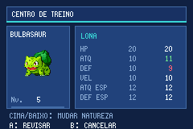

# Idioma, randomizer e interface — v0.4.0-dev

Em OPTIONS, a linha LANGUAGE alterna ENGLISH/PT-BR. A mudança aparece imediatamente e é persistida pelo save normal. A tela continua acessível durante a partida. O português é beta: 7.771 entradas traduzidas, 82 revisões manuais; a maior parte foi traduzida automaticamente e ainda requer revisão linguística. A fonte do GBA não contém todos os caracteres portugueses; os não suportados são transliterados. Nomes de espécies/golpes permanecem em inglês.

No NEW GAME, escolha Normal/Hardcore, confirme as regras e escolha Randomizer OFF/ON. B retorna ao modo; A confirma a configuração. Modo e randomizer ficam fixos na partida. Saves antigos recebem EN/randomizer desligado sem apagar modo, cotas de captura ou curas. O tamanho e os offsets antigos do bloco de save foram mantidos; migração de todos os saves reais ainda não foi homologada.

## O que o randomizer altera

- Encontros das tabelas selvagens de grama, água e pesca: espécies permutadas entre as 386, conservando níveis e pesos dos slots. Lendários ficam em um grupo separado; a trava anterior à Liga continua ativa.
- Três iniciais distintos e adequados ao nível 5, com golpe de dano disponível. O inicial correspondente do rival acompanha sua escolha e evolui conforme o nível.
- Times regulares e da Torre: espécies e golpes mudam, conservando nível, tamanho do elenco e itens. Golpes vêm do aprendizado por nível da espécie; a seleção evita ataques que acertem o parceiro.
- A permutação usa faixas de poder (BST até 350, 450, 550 e acima), com semente gravada. Ela conserva cada identidade enquanto o save é recarregado; não representa balanceamento competitivo garantido.

Presentes e encontros especiais iniciados por scripts continuam fixos. História, mapas e cotas Hardcore permanecem ativos. O primeiro encontro elegível é avaliado após a troca da espécie; duplicatas já capturadas não gastam uma nova cota. Os guias de encontros e times documentam o randomizer desligado. Ligado, as composições podem perder sinergia temática; não são mais as adaptações dos campeões oficiais.

## Treinamento dos desafios

Líderes, rivais (incluindo a primeira luta), chefes Rocket, Koichi, Bikers especiais, E4, Campeão e Torre têm seis IVs 31. E4/Campeão mantêm seus spreads definidos quando a espécie é a original. Os demais usam 508 EVs por função: rápidos recebem 252 no ataque relevante + 252 Velocidade + 4 HP; lentos recebem 252 HP + 252 no ataque relevante + 4 Defesa; suporte sem dano direto recebe 252 HP + 128 Defesa + 128 Defesa Especial. Shedinja recebe os quatro pontos em Defesa Especial. A natureza acompanha a função. Com randomizer ligado, o treinamento é adaptado à espécie criada.

Treinadores comuns continuam com a escala anterior de IVs. A primeira luta permanece simples, nível 5; o treino torna esse adversário mais forte. Novas revanches de ginásio continuam pendentes. A engine ainda usa golpes/tipos/cálculo de geração III.

## Cientista

Disponível nos 19 Centros, sempre no Hardcore e após a Liga no Normal. Retrato, seleção da equipe, barras de EV/IV, EVs restantes e prévia dos atributos ajudam a conferir mudanças antes da confirmação. Setas ajustam, L zera, R maximiza dentro do limite, A confirma e B cancela/volta. A natureza mostra comparação dos atributos calculados. Editar não cura nem revive; perdidos e ovos continuam bloqueados.

## Reprodução dos dados

`python scripts/generate_locale.py` gera o dicionário C a partir dos JSON de localização. A tradução automática opcional em `scripts/translate_ptbr.py` usa Argos Translate com modelo local en→pt; modelo e ambiente virtual não são distribuídos. A compilação normal usa o cabeçalho já gerado no patch de fontes e dispensa esse modelo. `python scripts/balance_trainers.py --check` confere o catálogo e os spreads documentados.
