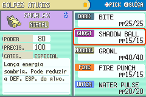

# Revisão da tradução PT-BR

Prévia v0.5.0-preview.3. O catálogo contém 7.865 entradas traduzidas e 1.202 substituições revisadas. A tradução completa da campanha ainda não foi revisada linguisticamente: muitos diálogos secundários continuam vindo do rascunho automático. [Cobertura](../games/super-fire-red/hack-data/localization/coverage.json) · [Resultados desta ROM](../games/super-fire-red/hack-data/ptbr_validation.json).

## O que mudou

- Reescritas as descrições dos 354 golpes implementados, com termos consistentes: golpe, usuário, alvo, equipe, precisão, evasão e hesitação. O texto descreve os efeitos desta engine; não promete os efeitos modernos ainda ausentes. Por exemplo, Rapid Spin não anuncia aumento de velocidade, e Sturdy não anuncia a regra moderna de sobreviver com HP cheio.
- Revisadas 288 descrições de itens, incluindo remédios, Poké Bolas, frutas, itens equipados, ferramentas da campanha e as 58 TMs/HMs existentes. O gerador agora inclui as descrições do arquivo JSON de itens, que ficavam fora do catálogo anterior.
- Revisadas descrições de habilidades, mais de 200 mensagens de batalha, menus de equipe/PC/Pokédex/lojas, opções, treinamento, evolução e diálogos iniciais de Pallet/Viridian/Oak.
- Incluídas as falas de recepção e cura dos Centros Pokémon, que estavam no arquivo de scripts `.s` e não entravam no catálogo anterior. A fala do tutorial de derrota foi encurtada para caber no espaço de mensagens de batalha.
- Corrigidos os caminhos de arquivos com barras do Windows: eles impediam a aplicação das quebras de linha nos diálogos. Agora 2.444 textos dos mapas usam largura em pixels e estimativas para nomes/variáveis. A pontuação permanece junto ao nome; os controles de página e as referências a valores são preservados.
- Protegidos identificadores de treinadores, apelidos da Torre, naturezas e habilidades contra traduções literais. Pokémon, golpes, habilidades e naturezas conservam os nomes usados nas tabelas do jogo. Os tipos nas descrições acompanham os nomes dos ícones da ROM.
- Os rótulos desenhados no fundo do resumo de golpes recebem texto PT-BR por código: **PODER**, **PRECIS.** e **CATEG.** A coluna dos valores e as descrições mantêm espaço próprio.

## Verificação

`games/super-fire-red/scripts/test_localization.py` confere as chaves contra os textos reais dos fontes, a presença das descrições de habilidades, os marcadores de nomes/valores/controles, os limites das descrições de itens e o orçamento das mensagens de batalha. `generate_locale.py --check` confere que as tabelas foram geradas a partir dos arquivos revisados; traduções revisadas inválidas impedem a geração.

`test_category_ui.py` mede as 354 descrições em EN e PT-BR no motor nativo e percorre dez posições da tela com botões. Os testes de opções, editor, lojas nos dois idiomas, captura, randomizer, save/reload, equipes e IA são registrados com o SHA da ROM atual. As imagens de opções, editor e resumo também são inspecionadas visualmente. A compilação limpa deve reproduzir exatamente o arquivo entregue.

Os testes verificam funcionamento e limites nas situações cobertas. Não equivalem à leitura de todos os diálogos da campanha, nem a uma campanha completa homologada. Os testes de 32 batalhas publicados na prévia anterior continuam associados ao SHA daquela versão.

## Limites e edição

A fonte original não contém todos os caracteres portugueses. Os acentos disponíveis são usados; `ã`, `õ` e suas maiúsculas são simplificados na ROM. Os arquivos de tradução preservam a ortografia completa para permitir a futura atualização da fonte. Alguns rótulos incorporados a outras imagens ainda conservam a arte original.

As traduções revistas ficam em `games/super-fire-red/hack-data/localization/*_ptbr.json`, além de `ptbr_overrides.json`. Os textos diretos do editor e do randomizer ficam nos respectivos fontes C. `ptbr_draft.json` permanece como rascunho de referência, sem receber aprovação automática de revisão. Para mudar uma descrição de golpe, edite `move_descriptions_ptbr.json`; para itens, `item_descriptions_ptbr.json`. Depois execute `generate_locale.py`, compile e repita os testes afetados.
