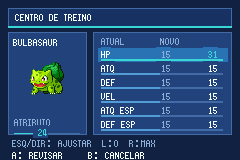
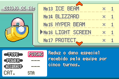
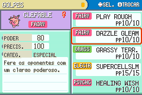
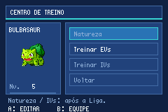

# Revisão da interface — 23/10/2026

Revisão incluída na [v0.5.0-preview.4](https://github.com/matheus013/firered-386/releases/tag/v0.5.0-preview.4), com **577 golpes (223 novos)**, Fada e o editor. ROM: `firered-386-v0.5.0-preview.4.gba`, SHA-256 `0b8e7bda6ee3a63846317f525a4b09e3accd8b87cf0d46db0502d4898fe6f63f`.

## Correções

- **Editor de IVs:** “PRÉVIA DO ATRIBUTO” atravessava o painel esquerdo e invadia a tabela. Agora mostra “ATRIBUTO”, dentro do espaço disponível.
- **Seleção de golpes em batalha:** a linha categoria/tipo excedia os 64 px da janela. Removida a troca para fonte maior no tipo; categorias abreviadas para PHY/SPE/STA em EN e FÍS/ESP/STA em PT-BR. O resumo mantém os nomes completos das categorias.
- **Estojo de TMs:** descrições preparadas para janelas mais largas apareciam sobrepostas ou cortadas no painel de 144 px. Agora são traduzidas, reformatadas para 140 px úteis e desenhadas em até cinco linhas. O título usa fonte pequena e centralização sem subtração negativa.
- **Resumo:** revisados os títulos e as instruções de seleção/troca em PT-BR; a posição horizontal das instruções não pode ficar negativa. Categoria, poder, precisão e descrição permanecem separados.

## Acesso ao editor

| Modo | EVs | IVs | Natureza |
|---|---|---|---|
| Normal, antes da Liga | Liberado | Bloqueado | Bloqueado |
| Normal, após a Liga | Liberado | Liberado | Liberado |
| Hardcore, desde o início | Liberado | Liberado | Liberado |

O cientista pode ser usado desde o início nos dois modos. No Normal, o menu apresenta IVs/natureza em cinza e informa o requisito. As funções de edição também rejeitam mudanças avançadas antes da Liga, mesmo sem passar pelo menu. O editor não cura nem revive; as restrições para ovos/Pokémon perdidos continuam ativas.

## Validação

- `scripts/test_ui_layout.py`: **4.814 medições nativas**, sem exceder os limites. Verifica nomes dos 577 golpes em batalha/resumo, categoria/tipo, categorias completas, instruções/títulos, rótulos do editor e altura das 58 descrições de TM/HM, nos dois idiomas. As capturas de batalha confirmam o controlador de seleção e percorrem os quatro golpes por botões; o estojo percorre as 50 TMs.
- `scripts/test_category_ui.py --expanded`: dez seleções reais em EN/PT-BR, incluindo Fada, categoria de status e nomes novos; **1.154 descrições** verificadas contra o limite de cinco linhas.
- `scripts/test_training_ui.py --mode normal`, com e sem `--language ptbr`: interação com o NPC, bloqueio de IVs/natureza, EVs com cancelamento/confirmação e saída/reabertura. A variante Hardcore mantém edição dos três e verifica três curas, com recusa da quarta.
- `scripts/test_training.py`: acesso por modo e vitória na Liga, validação dos valores, aplicação sem cura, preservação dos dados e recarga do save em outra instância.
- `scripts/test_settings_ui.py`: escolha inicial de modo/randomizer e opções EN/PT-BR por botões.
- `scripts/test_localization.py`: catálogo, chaves revisadas, controles/variáveis e orçamentos de texto. `scripts/test_new_moves.py`: 223 novos golpes conferidos contra os dados fixados. Os geradores de treinadores, encontros e guias passaram no modo `--check`.
- `scripts/test_ai_move_native.py`: 1.096 verificações, nenhuma falha. Testes dirigidos; não demonstram uma IA ótima nem vitória de campanha.
- `scripts/run_regression.py`: sete suítes aprovadas na ROM final (Hardcore, editor, interface, criação dos treinadores, encontros, lojas e Liga). Lojas também repetidas em PT-BR: 23 catálogos × dois modos × dois idiomas = **92 casos**, com compra, venda, cancelamento, saída/reabertura e preço do Rare Candy.

Os resultados estruturados e as referências de cada teste estão em [data/ui_review_validation.json](../data/ui_review_validation.json). A compilação limpa do patch reproduziu a ROM acima.

Durante a revisão, também passaram **121 verificações de efeitos em 181 batalhas isoladas**, na ROM `ef88f2fec4e0d9f0fc9251bab4383713e425742a05fdf9f0999de29ba370e4bb`. Esse snapshot precede os últimos ajustes de texto/desenho do estojo e do resumo; seu SHA é preservado na evidência, sem atribuí-lo à ROM final.

## Limites

As capturas de tela foram inspecionadas visualmente; a medição automatizada complementa essa inspeção. Não cobre cada combinação de Pokémon, apelidos, diálogos, animações ou estado de batalha. As fixtures fornecem Pokémon/itens e abrem as interfaces diretamente; não são uma campanha percorrida sem assistência. Os testes da Liga usam HP ampliado no jogador para observar a criação dos adversários e os turnos, e não medem dificuldade.

VBA Link e campanha completa sem assistência continuam pendentes. A tradução secundária ainda contém rascunho automático. A expansão dos golpes não equivale a todas as regras modernas implementadas; Ally Switch e Fling continuam ausentes do conjunto de 225 lacunas original, e o catálogo de TMs permanece com as 50 TMs existentes.
